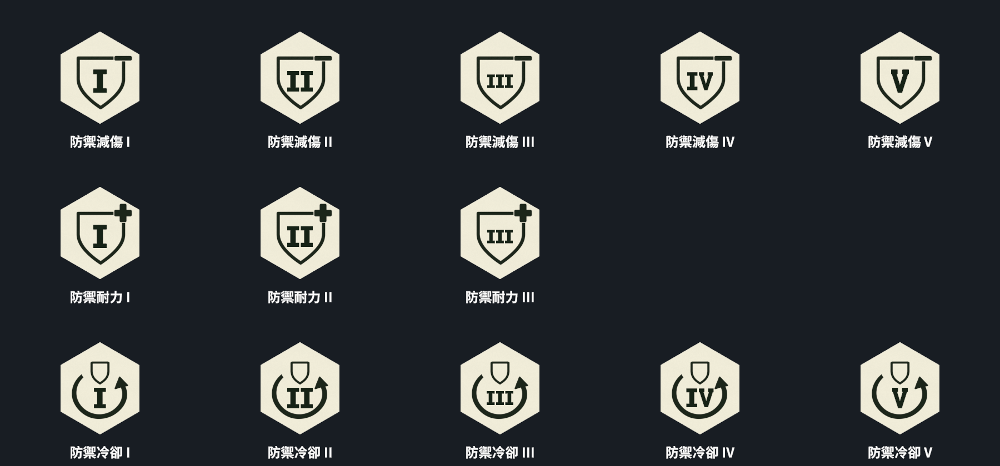

# 防禦三屬性 V2 圖示套用

最後核對日期：2026-10-19（本批圖示／設定／正式卡片局部核對）。

使用者核准 V2 預覽後套用。防禦減傷為盾牌＋減號、防禦耐力為盾牌＋加號、防禦冷卻為環形箭頭＋小盾牌；階級沿用 PurgersRankSlab SDF、TMP Bold 與 GrowthRewardRankView 各階字形適配。

## 資產與設定

- 正式資料：三份 Assets/_Project_Assets/Data/Progression/Growth/Reward_Guard*.asset。
- 圖稿：Assets/_Project_Assets/UI/GrowthIcons/GuardV2/RankBackgrounds/*_Base.png；三張與核准來源 SHA-256 完全一致，見 source-integrity.json。
- 相容入口：同資料夾上層 *_I.png，由相同 Unity UI／TMP 離屏繪製 I 階；growthIcon 指向此圖，growthRankBackground 指向無字原圖。
- 正式卡片仍以無字原圖＋下一階文字呈現，不會重疊兩個階級。減傷／冷卻 I～V，耐力 I～III，共 13 階。
- 中心、字框、倍率與匯入設定詳見 [168](../../../168_角色成長被動與技能掉落.md) 的「2026-10-19 防禦三屬性 V2 圖示套用」。
- 只透過 Editor API 修改上述三份 Reward 的圖示與階級設定；未改程式、玩法、權威、獎勵數值、Scene／Prefab 或原九項屬性設定。既有全量套版工具未執行。

## 驗證結果

1. 正式 StageHUD LeftCard 複本於 Preview Scene 離屏繪製 13 階，保留底板 71.28525×82.95008。完整圖稿邊長 64.156725、字形固定中心誤差 < 0.002、字框填量 0.94；rank-metrics.json 保存逐階字級／字形尺寸。正式原尺寸見 AllRanks-native.png；AllRanks-2x.png 僅提高輸出解析度。
2. 三張正式卡片 × 13 階，共 39 次引用／完整圖示／文字／置中／字框檢查通過；六張 Sprite 匯入設定核對通過，見 final-audit.json。
3. 聚焦 16／16 通過（GrowthIconIntegrationTests、AbilityIconFrameFitTests、GuardGrowthIntegrationTests），新鮮 RunFinished：2026-10-19T02:04:14.9841349Z，見 focused.xml／focused-summary.txt。
4. 完整 PurgersRegression：總數 1235，1229 通過、4 失敗、2 跳過。新鮮 RunFinished：2026-10-19T02:05:52.9277572Z，見 regression.xml／regression-summary.txt。這不是全綠；四項與先前既有失敗相同：
   - BossStageAssetTests.GameSceneContainsBossAssetWiring：Boss Chunk 引用不一致。
   - EnemyFlytrapAssetTests.TimingDefaultsMatchApprovedRules：預期 0.5，實際 0.25。
   - EnemyReflectorAssetTests.SeparatePrefabUsesExistingCombatAndHealthOwners：預期 >80，實際 75。
   - ReloadCameraRuntimeTests.SpawnedLocalWeaponsDriveOnlyPresentationAndUnbindClearsIt：NullReferenceException。
5. preserved-before.json／preserved-after.json：54 個既有檔案 SHA-256 保持相同，包含 V5 圖示／meta、StageHUD、SafeHouse、_Menu。保留原工作樹內其他 Agent 的未提交修改。
6. Editor 回到 _Menu、非 Play／非編譯；Console 錯誤 0。Resources 中的一個 Runner 是 persistent Prefab 資產（無有效 Scene、非 Running），沒有活躍場景 Runner。背景檢查沿用 PlayUnfocused（2）與 Run In Background，未聚焦任何視窗。

離屏圖是真實正式 UI 元件的受控驗證，未替代自然遊玩、獨立 Host／Client 或 Build。本批純本機美術／引用調整，未重新宣稱玩法／聯機驗收通過。render-method.cs.txt 保存本次離屏方法體，供 MCP execute_code 重現；不加入 Assets 編譯。

