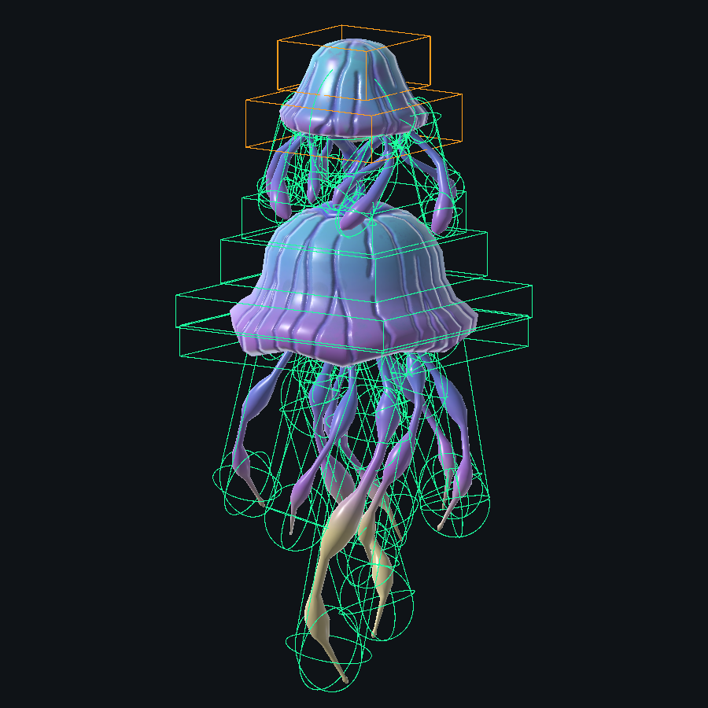

# 水母遠程飛行敵人碰撞校準

最後核對：2026-10-18。正式 Enemy_Ranged_A 已由 Editor 套用；專項、受控聯機與完整回歸已完成，完整回歸保留 4 項既有失敗。

## 已確認規則與配置

- 保留水母模型、材質、骨架、Animator Controller、動畫檔與原有 Transform；沒有改動地圖 Scene／MapChunk 資產。
- 單一既有 Fusion HitboxRoot 下共 31 個部位：小傘頭 2、連接頸 1、短觸鬚 8、大傘身 2、裙緣 2、長觸鬚 16（每串兩段）。小傘頭標 WeaponHitZone.Head，其餘 Body；部位額外倍率均為 1，武器既有爆頭倍率保留。
- 這是隨動畫變形的簡化 Box／Capsule 組合，不是逐三角形 MeshCollider；維持觸鬚分開，不能以整束碰撞替代。
- EnemyJellyfishCollisionPose 使用 287 個預先選定的四權重蒙皮點、109 個原骨架引用，在 Animator 更新後同步 Collider／Fusion Hitbox 的位置與尺寸。不更改動畫、不增加 NetworkBehaviour、不讀取 Runtime Mesh、不逐幀 BakeMesh，也不持有生命、傷害或移動權限。
- 這隻 Prefab 的 24 個 SkinnedMeshRenderer 固定 SkinQuality.Bone4，避免全域 Performant（2 骨骼）與其他畫質造成蒙皮輪廓／四權重碰撞樣本差異。僅限此 Prefab；低畫質下蒙皮成本高於原本 2 骨骼，未更動專案全域畫質或 FBX。
- 既有 CombatDeathHandler 的 Collider 停用清單改為全部 31 個部位，原 HitboxRoot 停用引用保留。舊 Body／Head 物件身分保留，只移除舊碰撞元件。

## 避障與出生

巡邏與追逐共用設定：Radius=5.7、Height=14.05、Body Base Offset=-2.65、Skin=0.1、Obstacle Mask=Default（1）。模型下垂觸鬚可低於 Root；底部偏移不可直接歸零。原值巡邏為 2.85／12／0.2，追逐為 0.35／1.8／0.02。

EnemyCollisionPassage 沿 Runner 的 PhysicsScene 做起點 OverlapCapsule 與路徑 CapsuleCast。EnemyChaseMotor 原有位移、部分行進距離與旋轉裁決保留。飛行擊退沿 Navigator 整體包絡，避免新增子膠囊後誤用第一條觸鬚。

EnemyFlyingPatrolNavigator.SpawnRootOffset 由負底部偏移推導（本 Prefab 為向上 2.65）。EnemyEncounterDirector 在每個飛行 Prefab 的巡邏種子與實際出生取樣一致套用補償，原地圖出生盒仍作為底部基準；零偏移飛行資產、Ground、Stationary 保持原取樣。這沒有抬升模型相對 Root，也沒有改寫共用出生盒。

MapChunk_Prototype 的 8 區實測：原舊包絡各 16 點；新包絡不補償時各 0 點；補償後各恢復 16 個可達點。

## 資料與成本

- 校準資料：[ReviewedLayout_20261018.json](ReviewedLayout_20261018.json)。保留原骨架路徑、分段、蒙皮點、Padding 與移動／broadphase 包絡。
- Controller 使用中的 8 段動畫，共取樣 151 個姿勢（含死亡）；140 個存活／Rest 樣本用於受擊校準。選點後各部位所有取樣頂點均落在對應幾何內，Padding 約 0.035～0.060 公尺。這不等同任意 Blend／網路延遲下的視覺驗收。
- HitboxRoot BroadRadius=11.412961，Offset 約 (-0.050575, 4.556955, 1.675075)。此範圍包含攻擊伸展，不能用來取代平時避障尺寸。
- 本機 Fusion DLL 證實單 Root 上限 31；CapsuleExtents 是完整高度。SetColliderData 每次快照會讀取當前幾何欄位，Collider 與 Hitbox 尺寸必須一起更新。
- 每隻上限 1024 蒙皮樣本，實際 287；更新時重用陣列。Editor 暖機後 500 次 RefreshPose 平均約 0.201 ms／隻，僅為此機器 Editor 微基準，不能當成 Player／大量敵人效能驗收。原模型網格、材質與貼圖成本未增加；物理形狀由 6 增為 31。

## 驗證狀態

- 離線純幾何 NUnit：先取得預期失敗 2 passed／3 failed，實作後 5／5。
- Unity 第一輪：7 passed／3 failed；擊退誤用觸鬚是預期行為失敗，另兩項為 EditMode 測試錯用 SceneManager.CreateScene。改用有獨立物理場景的 PreviewScene 並修正擊退後 10／10。
- 最後專項：[14／14 通過](Focused.txt)，涵蓋出生補償、蒙皮／Collider／Hitbox 配對、擊退包絡及畫質設定。畫質測試先確認 Auto／Bone4 預期失敗，再套用修正。完整結果見 [Focused.xml](Focused.xml)。
- 實際 Animator 240 次更新、3 個 State：所有部位仍在 broad sphere 內。
- [隔離 Host／Client／晚加入驗證](Runtime.txt)：34 個 PASS 檢查，另 3 個 INFO。舊執行報表首行「通過 37」包含 INFO，統計程式已修正；實際 PASS 為 34。驗證 Host 權限、Client 不能提交血量、上方小傘頭與大傘身 lag ray 分類、既有 DamageReceiver 傷害路徑、血量同步、避障與死亡停用全部部位。Runner 已 Shutdown 並退出 Play。
- 此受控測試為隔離命中與傷害路徑，射擊時將雙端 Animator 固定在同一 idle 姿勢；另有活動 Animator 更新檢查。沒有模擬玩家實際持槍輸入。第一輪因測試錯誤要求 proxy 註冊伺服器 HitboxIndex 而失敗，修正後完成；proxy 沒有 lag-compensation Manager 是既有 Fusion 行為。
- 模型／材質／動畫來源 25 個檔案 SHA256 與整合前完全一致。完整 PurgersRegression：[1219 通過／4 失敗／2 跳過，總數 1225](Regression.txt)，證據為本次新鮮 [RunFinished XML](Regression.xml)。四項失敗與前一順位 [GuardGrowth 的 1205／4／2 基線](../GuardGrowth/README.md) 完全相同：BossStageAssetTests.GameSceneContainsBossAssetWiring、EnemyFlytrapAssetTests.TimingDefaultsMatchApprovedRules、EnemyReflectorAssetTests.SeparatePrefabUsesExistingCombatAndHealthOwners、ReloadCameraRuntimeTests.SpawnedLocalWeaponsDriveOnlyPresentationAndUnbindClearsIt。未放寬斷言或改動上述功能，不宣稱全套件綠燈。
- 最終重新載入 Prefab：31 Hitbox／31 Collider／2 Head／31 有效死亡停用引用，31 Hitbox 均指向原單一 Root，Missing Script=0，24 Renderer 均為 Bone4。Console Error=0；編譯完成。原 Body／Head 物件保留。
- 完整回歸後確認已退出 Play、Running Runner=0、回到原 `_Menu`；清除 MCP 跨 Domain Reload 遺留的 running 工作狀態後釋出 Editor。離線隔離 worktree 已封存可恢復；正式變更在主工作區，未提交。
- 程式檔 diff whitespace 檢查通過；Prefab 的空欄位尾端空白由 Unity 序列化器產生，未手改 YAML 清除。
- Build、獨立程式、自然遊玩／視覺與延遲射擊驗收尚未執行。

## 索引候選（尚未要求收錄）

ENEMY-JELLYFISH-COLLISION：水母、遠程飛行碰撞、小傘頭爆頭、分段觸鬚、Enemy_Ranged_A、EnemyJellyfishCollisionPose、bodyBaseOffset。正式規則與設定由本文件及 90／91／164 路由；新增索引條目仍待使用者確認。