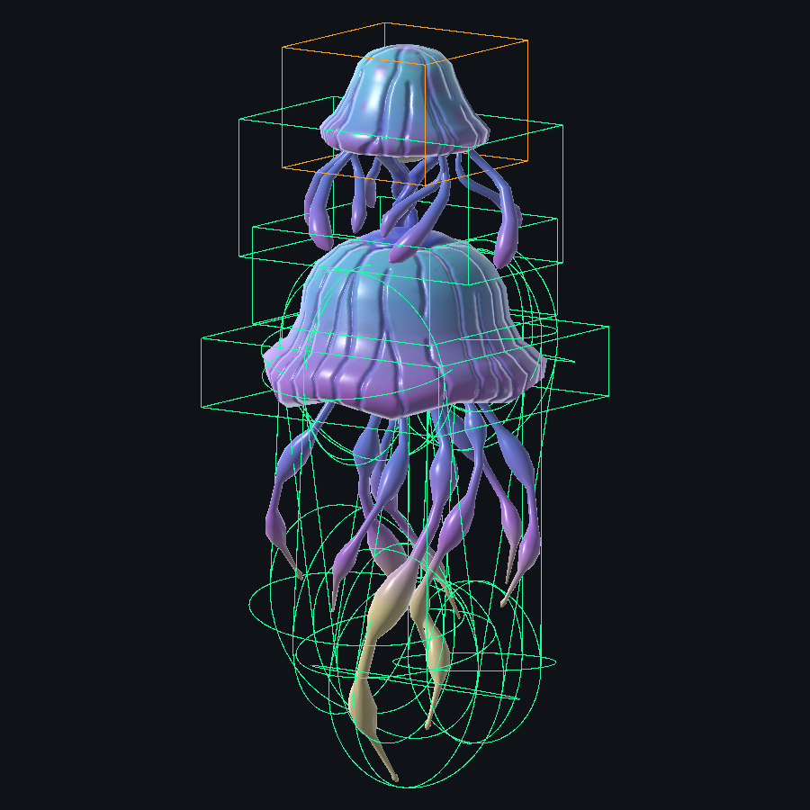

# 水母 A／B 八區塊碰撞

最後核對：2026-10-18。使用者已確認由細分方案改成 8 大區塊，適用 Enemy_Ranged_A、Enemy_Ranged_B。正式 Prefab 已由 Editor 遷移；17 項專項通過，A／B 聯機各 34 項通過，完整回歸 1222 通過／4 項既有測試失敗／2 跳過。

## 已確認規則

| 區塊 | 數量 | 命中分類 |
|---|---:|---|
| 上方小傘頭 | 1 | Head |
| 連接頸與短觸鬚 | 1 | Body |
| 大傘身 | 1 | Body |
| 裙緣 | 1 | Body |
| 長觸鬚前／後／左／右 | 4 | Body |

每個區塊一組 PhysX Collider／Fusion Hitbox，單一原 HitboxRoot 下共 8 組。部位額外倍率皆為 1；爆頭仍沿武器既有倍率與 DamageReceiver，不新增傷害 owner。較大的區塊會包含部分觸鬚間空隙，這是已確認簡化方案的取捨，不是逐三角形碰撞。

模型、材質、骨架、原 Transform、Animator Controller 與動畫保留。A／B 使用相同 FBX、24 個 SkinnedMeshRenderer，原模型 Transform 核對無差異。固定 Bone4 以維持四權重蒙皮與命中幾何一致；未更動全域畫質。舊 Body／Head 物件保留，只移除舊命中元件與先前生成的碰撞節點。死亡停用清單為全部 8 個 Collider，原 HitboxRoot 引用保留。

B 在本輪開始時存在舊 6 組及複製的 31 組碰撞，部分 Root 引用缺失，且沒有動態 Pose 元件；本輪清理為 8 組並重新接線，保留既有雷射與其他元件。

## 避障維持原校準

兩隻沿上一輪已核對的相同包絡：Radius=5.7、Height=14.05、Body Base Offset=-2.65、Skin=0.1、Obstacle Mask=Default（1）。A 數值不變；B 原來未套用（巡邏 2.85／12／0／0.2、追逐 0.35／1.8／0／0.02），本輪對齊已校準配置。沒有重新調整半徑、高度或地圖。

巡邏／追逐仍由 EnemyCollisionPassage 在 Runner PhysicsScene 查起點占用及 CapsuleCast。既有位移、旋轉、MovementOwnership 與 State Authority 不變。飛行擊退讀完整 Navigator 包絡，出生 Root 與巡邏種子沿既有 SpawnRootOffset 向上補償 2.65；沒有修改 Scene／MapChunk。上一輪地圖八區各 16 可達點的證據見[歷史紀錄](History_31Parts.md)。

## 動畫、資料與成本

- [八區塊校準資料](ReviewedLayout_Eight_20261018.json)：126 個預選四權重蒙皮點、82 個原骨架引用。相較 31 塊版本的 287 點／109 骨架減少；Runtime Pose 類別及更新方式不變，沒有逐幀 BakeMesh／讀 Runtime Mesh。
- 沿相同 8 段 Controller 動畫的 151 姿勢資料，140 個存活／Rest 樣本重新選點。每個區塊的所屬模型頂點，在所有已取樣姿勢均落於對應幾何內。這不代表任意動畫混合／延遲下的自然遊玩驗收。
- 上方四塊為 Box，下方四組為 Capsule；CapsuleExtents 沿本專案 Fusion 定義使用完整高度。Collider 與 Hitbox 尺寸一起更新。
- 受擊粗略搜尋球依合併後幾何重算，中心約 (-0.380592, 4.842239, 2.161428)，Bounds Size 約 (11.369304, 15.162697, 15.383656)；它不是移動避障包絡。
- 網格、材質與貼圖成本不變；每隻物理形狀為 8。低畫質仍保留 Bone4 的蒙皮成本，不將舊 31 塊的 0.201 ms 微基準當成新版效能結論。

## 驗證

- 修改前 [RED](EightRed.xml)：A 預期 8、實際 31；B 預期 8、實際 37，兩項預期失敗。首次新測試曾因 Assert 名稱歧義未編譯，0 項結果不列為通過，修正測試後才取得 RED。
- 最終專項：[17／17 通過](EightFocused.txt)，[RunFinished XML](EightFocused.xml)。包含 A／B 實際資產的 8 組、唯一爆頭、死亡清理、Root 引用、避障數值，以及重複遷移保留骨架／Transform、蒙皮幾何與 PhysicsScene 邊界。
- 受控 [A 34 項](EightRuntime_A.txt)／[B 34 項](EightRuntime_B.txt) 全數通過：活動 Animator 更新、8 組 Root 註冊、唯一 Head、Collider／Hitbox 配對、Client lag ray 分類、既有傷害路徑、Host 權限、血量同步、晚加入、避障與死亡清理。射擊時固定雙端同一 idle 姿勢以隔離命中接線，沒有模擬實際武器輸入或延遲遊玩。
- 完整 PurgersRegression：[1222 通過／4 失敗／2 跳過，共 1228 項](EightRegression.txt)，取自本次新鮮 [RunFinished XML](EightRegression.xml)。失敗測試仍為 BossStageAssetTests.GameSceneContainsBossAssetWiring、EnemyFlytrapAssetTests.TimingDefaultsMatchApprovedRules、EnemyReflectorAssetTests.SeparatePrefabUsesExistingCombatAndHealthOwners、ReloadCameraRuntimeTests.SpawnedLocalWeaponsDriveOnlyPresentationAndUnbindClearsIt。
- 前三者中的 Reflector 這次先在射程斷言失敗（75 未大於 A 的 80），上一輪是在傷害斷言失敗；本輪開始的 A 備份已是 maximumStartDistance=80、projectileDamage=10，套用後兩值不變。其餘三項失敗訊息與上一輪相同。未修改反彈敵人或放寬斷言，不宣稱全回歸綠燈。
- [最終資產核對](EightAssetCheck.txt)：A／B 各 140 姿勢均未超出 BroadRadius=12.30477，8 Hitbox／1 Head／8 有效死亡引用、Missing Script=0。模型／材質／動畫來源 25 檔 SHA256 與上一輪原始備份完全相同。編譯完成，Console Error=0。
- 已退出 Play、Running Runner=0、回到 `_Menu`，Editor 已釋出。主工作區變更保留未提交。
- Build、獨立程式、自然遊玩／視覺與延遲射擊未驗證。

## 歷史與索引

[31 塊版本紀錄](History_31Parts.md)與舊 ReviewedLayout_20261018.json 僅供追溯，不能再套用為正式配置；遷移工具現在只接受八區塊。新增索引仍未獲要求收錄；候選關鍵詞：水母八區塊、小傘頭爆頭、Enemy_Ranged_A／B、EnemyJellyfishCollisionPose。