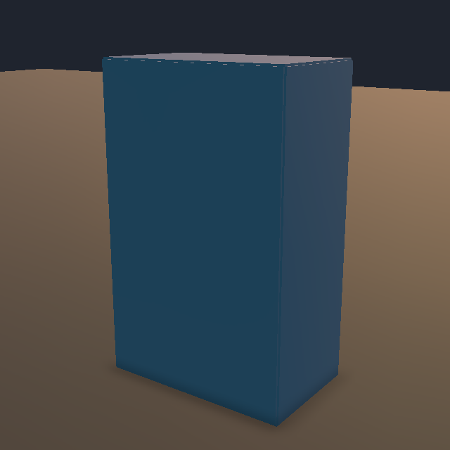
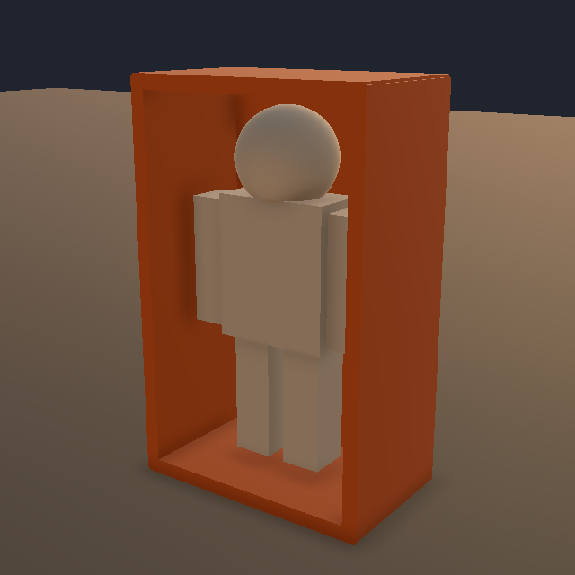

# 反彈護盾敵人驗證紀錄

日期：2026-10-14（本功能局部驗證）。規則與 Inspector 見 [94](../../94_反彈護盾遠程敵人.md)。

## 2026-10-14 槍擊改為反彈（目前版本）

本輪使用者確認：只作用於反彈護盾敵人的專用子彈；槍擊改為沿該發實際射擊方向反彈，打回原射手觸發暈眩與背盾開口、命中不扣血。下方原消彈驗證保留為歷史，不能作為目前玩法。

- 先修改受控 Play Mode 斷言，在舊程式取得「Rifle reflects nearest projectile without destroying it or piercing」預期失敗，再修改正式程式；見 [失敗紀錄](shot-reflection-red.txt)。
- 聚焦 EditMode [22／22 通過](shot-reflection-focused.txt)。
- [Single Runner 65 項通過](shot-reflection-single.txt)：Rifle／SMG 正式權威射線、實際射擊方向與俯仰、最近彈攔截、牆擋、原射手／位置／速度保留、清除追蹤、零方向拒絕、未啟用槍擊反彈者不受影響、重複槍擊改向不延壽，以及打回原射手開盾／暈眩不扣血。亦驗證槍擊反彈後仍禁止下一發、到期 Impact 暫留及 Despawn 後恢復攻擊。
- [同 Editor 受控 Host／Client 84 項通過](shot-reflection-host-client.txt)：包含上述循環、Input Authority 不能直接寫入反彈、Client 實際 F／Fire NetInput 經 Host 處理及反彈狀態／方向同步；既有護盾晚加入與重連流程通過。
- 沿用原武器查詢與反彈 Networked 狀態，沒有新增投射物歷史回溯。兩把武器的指定方向測試以正式 Hitscan callback 驗證；Client Fire 另走實際 NetInput。獨立程序、高延遲及自然操作手感仍未驗收。
- 本輪不修改 Scene／Prefab／平衡數值；Inspector 改顯示 Reflectable By Player Shots，保留原序列化欄位與人工設定。

- 完整 PurgersRegression：[878 通過、1 失敗、1 Explicit 略過，共 880 項](shot-reflection-regression.txt)。唯一失敗仍是既有 `BossStageAssetTests.GameSceneContainsBossAssetWiring`；略過為 `AbilityToggleInputTests.HostClientInputLateJoinAndReconnectUseAuthoritativeToggleState`，不可宣稱全綠。
- 首輪在隔離空場景跑全回歸時，另有技能測試因 `FirstPersonHitCameraShake.Singleton = NULL` 失敗；[保留首輪紀錄](shot-reflection-regression-empty-scene.txt)。回到原 `_Menu` 場景重跑後該失敗消失，未修改技能／鏡頭程式。MCP job 跨 Domain Reload 保留舊進度，因此以 Unity RunFinished 回呼結果為證據；確認 IsRunActive=false 後才清理孤立 job。
- 編譯完成且最終 Console error 為 0；本輪未新增編譯警告。既有 DemoController、TankPreparationRuntimeVerification、BattleHudReferenceLayout 警告仍在；受控空場景曾記錄缺少 CameraFollow。結束時已退出 Play Mode，回到 `_Menu`，Scene 不為 dirty，未保存測試場景。

## 前輪已執行（含舊消彈行為）

- 2026-10-14 修訂先取得 3 項資產測試預期失敗（Ground、六面盾、1.5 倍彈體），才修改；見 [失敗紀錄](ground-red.txt)。正式 Prefab 已完成 Ground 元件與高度遷移，新增測試涵蓋底盾落地、槍口、四面盾引用與尺寸。
- 新增完整 AI 受控驗證：使用未停用索敵／攻擊的敵人，沿既有出生前巡邏契約生成；確認原地轉向並射擊而無巡邏／追擊位移。反彈 fixture 保留 Ground 巡邏／追擊 owner，只停用感知／警覺來隔離額外射擊。
- 開口期間另外五個方向皆阻擋傷害，四面新增盾維持橘色，恢復後藍色；晚加入及重連的 Client 額外核對四面盾顏色。

- 先新增 10 個純規則測試，取得 10 個「尚未接入反彈護盾敵人的共用規則」預期失敗，才實作。[原始回報](red-tests.json)。
- 聚焦 EditMode：22／22 通過，含近距追蹤、有限角速度、反彈禁追蹤、背部方向、資產光學／碰撞分離、無缺失腳本或破損引用、未 Spawn 安全查詢、盾板位置與 Hitbox broadphase。[結果](focused.txt)。
- Single Runner 57 項、同 Editor 受控 Host／Client 76 項皆通過：[單人紀錄](single.txt)、[多人紀錄](host-client.txt)。驗證真實 NetworkObject、SphereCast、共用傷害管線、四種正式出傷入口、暈眩與護盾呈現、恢復、隔牆拒絕反彈；多人另含晚加入、重連、Input Authority 拒絕直接寫入，以及 Client 的 F／Fire NetInput → Host 正式反彈／消彈 → Client 同步。
- 完整 PurgersRegression：795 通過、1 失敗、1 略過，共 797 項；[Unity 完成回呼紀錄](regression.txt)。失敗為既有 `BossStageAssetTests.GameSceneContainsBossAssetWiring`；略過為標記 Explicit 的 `AbilityToggleInputTests.HostClientInputLateJoinAndReconnectUseAuthoritativeToggleState`。不可宣稱完整回歸全綠。
- 編譯成功；目前未發現本功能新增 C# 編譯警告。測試用空場景曾有缺 CameraFollow／巡邏區警告；既有 DemoController、TankPreparationRuntimeVerification、BattleHudReferenceLayout 編譯警告不在本次修改範圍。

## 工具與測試邊界

- 第一次用 test_names 指定整個 Fixture 未真正執行個案；後續使用 group_names 並確認非零測試數，不採用前次空結果。
- 編譯過程修正驗證腳本誤引用 Editor assembly 與 NUnit／Fusion Assert 同名問題；修正後確認型別已載入再重跑。
- 完整回歸第一輪曾有四項 scheduler／EditMode 生命週期失敗；Play Mode 驗證後重跑未重現。保留最新完成結果，未改動那些測試或玩家系統。
- 部分回歸測試跨 Domain Reload 後，MCP job 仍顯示 running／34 completed；沿用既有 EnemySuicideTestResults.Arm 記錄完整 Unity RunFinished 結果。已確認 TestRunnerApi.IsRunActive=false，再清除孤立 MCP job。
- 第一次重連採測試實例 30 秒破綻，連線往返期間破綻到期，等待失敗；後改測試實例為 300 秒通過。前輪正式 Prefab 的 Stun Seconds 是 2 秒；本輪保留使用者後續改成的 4 秒，基本循環另驗證到期恢復。
- Host／Client 在同一 Editor、不同 Runner／Physics Scene。並非獨立程序／外部玩家的延遲與手感驗收。Attack／Support F 與 Tank 出傷入口採受控 callback；Client F 另走實際 NetInput。其他三條遠端自然輸入路徑仍需人工實測。
- 最後審查將破綻期間的擊退拒絕收窄到新敵人的 IEnemyAbilityKnockbackCondition，保留其他敵人規則；重新跑單人／多人與聚焦回歸確認。
- 反彈查詢使用 Host 當前彈位置，未新增投射物歷史回溯。高延遲反彈容錯、自然 Encounter、建置與大量同屏效能尚未驗收。
- 正式 Scene／生成區仍須人工配置。測試結束返回原 _Menu，退出 Play Mode；不儲存測試場景。

## 畫面核對

使用實際 Runtime 護盾狀態截圖；基礎方塊與球體、不代表正式美術。

| 藍色完整防護 | 橘色五面盾、背部開放 |
|---|---|
|  |  |

## 本輪反擊功能驗證補充

- [初始失敗](counterplay-red.txt)：先確認新選項與規則缺失。另兩項舊測試把可調參數鎖死在前輪值，已改成檢查合法範圍及視覺／碰撞一致性，保留使用者 4 秒暈眩與 0.5 m 半徑。
- 單人新增單發留場、反彈留場、Impact 暫留、擊毀／自然到期解鎖、Rifle／SMG 正式權威射線消彈、最近彈攔截、牆擋、反彈擴張邊界與無傷近失彈警覺。
- 仇恨隔離測試首輪因現有 360 度視野而提前發現玩家；只把測試實例視野設成 90 度後，成功驗證背後近失彈 → 原警戒佇列 → 站定轉向 → 看見後開火。正式資產維持 360 度。
- 新增縮放父物件下的球體世界直徑連動測試；碰撞球、視覺球與 Gizmos 共用 Collision Radius。
- 新增 Client Fire 測試首輪誤以 NonPublic 反射取得 public GetGameplayShotOrigin，修正成直接呼叫後重跑；此失敗在測試腳本，該輪未作為 Client 消彈成功證據。
