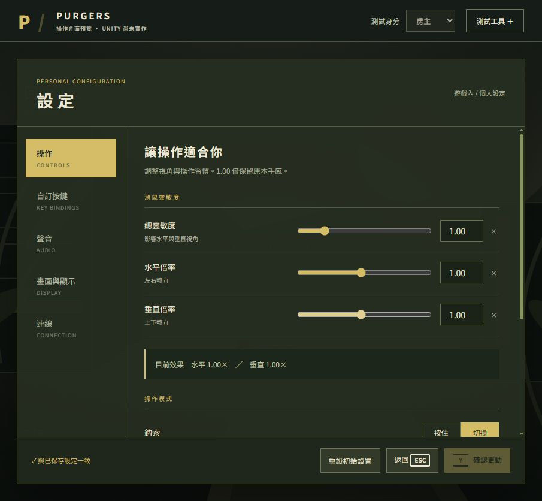

# ESC／玩家設定：預覽與驗證紀錄

日期：2026-10-17（Asia/Taipei）。規格：[104 完整定案](../../104_ESC選單與玩家設定.md)，索引：[PLAYER-SETTINGS](../../關鍵詞規則索引.md#player-settings)。

## 狀態

- **設計已定案；後續 Unity 獨立預覽已建立，正式遊戲未整合。** [Unity 預覽入口與本輪驗證](Unity/README.md)。以下網站測試與「未呼叫 Unity」均為前一階段歷史紀錄。
- **網站已私人部署**：[開啟互動預覽](https://purgers-settings-prototype.pink-river-0744.chatgpt.site)。需擁有者 ChatGPT 帳號登入；本機 IAB 無登入階段，部署後停在登入畫面，未代填帳密，也未改成公開。
- Sites 回傳 succeeded；本機同版網站經瀏覽器操作。部署後登入內網站未再驗證，不混稱遠端端到端測試。
- 不連 Photon、不讀寫正式存檔、不改桌面解析度；只保存該網站 origin 的瀏覽器設定。
- [網站來源 ZIP](SettingsPreview-source.zip)：解壓後用 Node 22+ 執行 `node server.mjs`，再開 `http://127.0.0.1:4317`，不需安裝 npm 相依。localhost 與私人網址分別保存設定。

## 測試入口

1. 初始為 ESC 小選單；測試滑鼠、滾輪、↑↓、Enter、ESC，底部有房間號與複製。
2. 設定 → 自訂按鍵：換彈改 Space，跳躍變空白紅底。Q／E 改鍵看圖片預覽，保存後看遊戲 HUD。
3. 改鍵時 Y 只綁定；再按 Y 開保存彈窗。空白操作列警告，仍可保存。
4. 修改後 ESC：是保存返回，否放棄返回，ESC 留在編輯；切頁保留草稿。
5. 右上測試工具：投票／倒數、設定及房主存檔失敗、頭頂障礙與四動作狀態。
6. 頂部選房主／加入者測不同離開文案。主選單入口可從工具或模擬離開到達，右上設定共用資料。
7. 顯示開 FPS／延遲後保存；解析度／全螢幕有 15 秒保留／還原模擬。聲音頁有短合成音試聽。
8. 重設先確認，只變草稿，仍須 Y／按鈕保存；重載可檢查持久化。

## 實際驗證

- Node 語法檢查通過；規則測試 **11／11** 通過：預設、衝突、Q／E 群組、ESC／Y、草稿隔離、數值限制、ESC 優先、空白持久化、壞資料回復、寫入失敗、重設。
- 本機 IAB 操作通過：滑鼠開設定、滾輪選取、方向鍵／Enter、數值輸入、鍵盤及滑鼠改鍵、衝突清空及圖片、Y 改鍵不保存、Y 保存警告、空白保存、重載後 HUD 鍵保留。
- 本機流程通過：解析度 15 秒逾時還原且其他修改留草稿；ESC 先取消投票且選單保留；未保存選否放棄；房主存檔失敗留房間；房主成功及 Client 離開回主選單；主選單共用設定；重設確認保存；設定寫入失敗留草稿。
- 當次本機瀏覽器 error／warn 查詢為空。設定頁截圖見下方。
- 本輪前後 Assets/Scripts、Assets/Scenes、Assets/Prefabs **1,446 個檔案 SHA-256 完全一致**。未呼叫 Unity Editor、編譯、測試或保存場景。

## 未驗與限制

Unity 編譯／Console、EditMode／PurgersRegression、Play Mode、Host／Client、晚加入／重連、獨立程序、Build、自然操作及最終美術全部待實作後驗收。網站不驗 KCC／碰撞／技能權威／真實存檔；動作僅狀態與準心模擬，音量為合成音、Ping 模擬、FPS 為網頁幀率。部分系統鍵及側鍵可能被瀏覽器保留，複製受剪貼簿權限限制。未逐項測所有裝置／尺寸及模式組合。

畫質、解析度、幀率、連線清單為預覽示例，不能覆蓋 Unity 資產；背景為介面情境示意，不是實機截圖或已接受的新場景設計。

## 部署與來源

- Site：`appgprj_6ad38bddc0948191a76af34aead5ee6c`（擁有者私人，未擴大分享）。
- Source commit：`7e4e960f7600cd96025ac0da5e5f2029e47ca917`，屬獨立網站庫，非 Purgers 遊戲 commit。
- Version：`appgprj_6ad38bddc0948191a76af34aead5ee6c~appgver_af8664ae21e081918967c87fe5a53ff4`。
- Deployment：`appgdep_6ad390abd2f08191b285ffec01d11d59`，succeeded。
- 工作目錄：`C:/Users/hsuai/.codex/visualizations/2026/10/17/01a14a41-10c7-7901-9f0a-1b1f617134f9/purgers-settings`。
- Windows 發布使用既有 Git Bash；僅子程序設定該獨立目錄 safe.directory 及 TAR_OPTIONS=--force-local，未改全域 Git 設定、未安裝軟體。短效憑證只經 stdin、不存檔。

文件檢查：104 與本紀錄的本機 Markdown 連結皆存在；來源 ZIP 已核對含 10 個網站檔案，不含 Git 歷史或憑證。git diff --check 在既有 00 快速文件尾端回報空白行，本輪只於其頁首新增路由，保留原尾端未更動。
