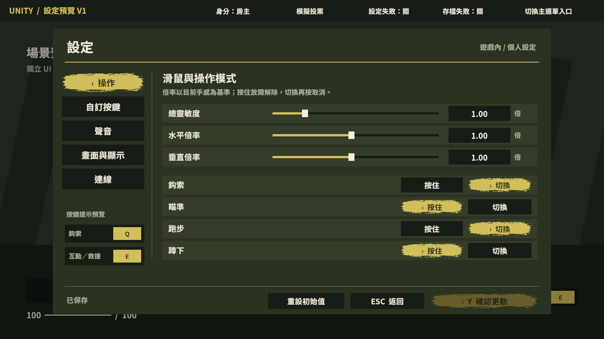
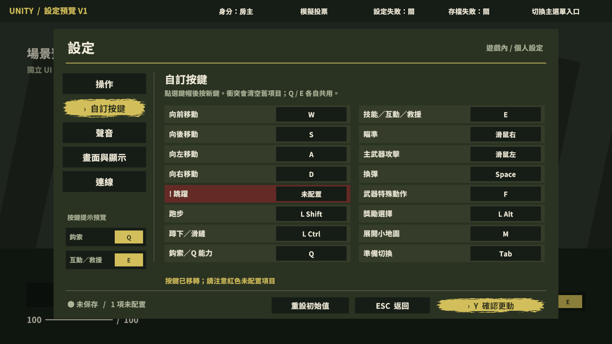
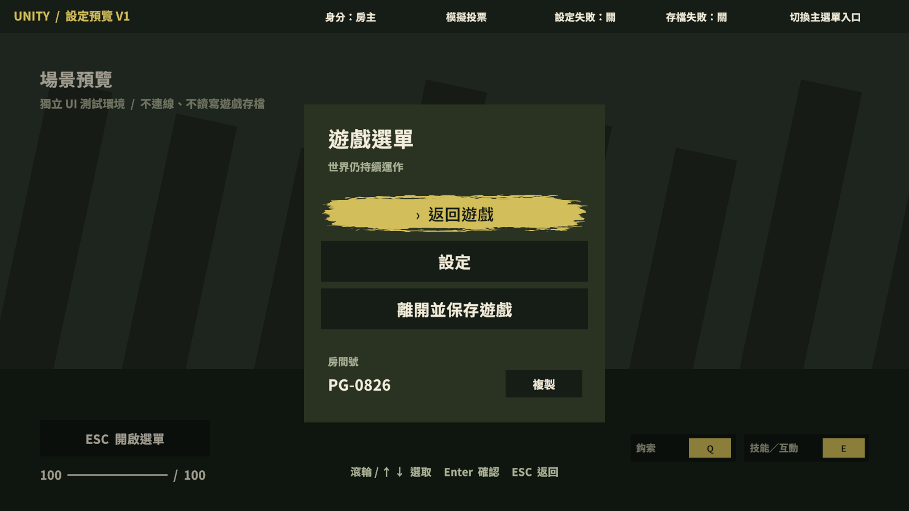

# Unity 設定預覽 V1（正式遊戲未整合）

日期：2026-10-17。使用者授權先做 Unity 版看效果與迭代，尚未授權接入正式遊戲。
完整定案：[104](../../../104_ESC選單與玩家設定.md)。網站前階段：[紀錄](../README.md)。

## 如何開啟

1. Unity 選單：`Tools > Purgers > Settings Preview > Open isolated preview scene`。也可直接開啟 `Assets/SettingsPreview/SettingsPreview.unity`。
2. 若原場景有未保存修改，手動入口會詢問保存／放棄；請自行決定。工具不會自動保存正式場景。
3. 按 Play，再由你點入 Game View。初始為模擬遊戲畫面；按 ESC 或「ESC 開啟選單」。
4. 優先看 1920×1080、1280×720；也提供 1920×1200、2560×1080 離屏畫面。固定 1600×900 安全版面置中縮放，寬畫面保留兩側留白。

## 可以測什麼

- 小選單滑鼠、滾輪、↑↓、Enter；房間號複製、房主／玩家離開文案。
- 操作、按鍵、聲音、畫面與顯示、連線五頁，共享草稿。
- 靈敏度／音量滑桿＋數值框、數值限制、左右鍵細調；原生下拉選單。
- Q／E 群組改鍵、衝突清空、整列紅底、左下鍵帽預覽；保存後模擬 HUD 跟隨。
- Y／按鈕保存、預設「否」、未保存返回、重設草稿、允許空白警告後保存。
- FPS／延遲保存後右上顯示；解析度／全螢幕 15 秒保留／還原流程。
- 頂部工具切換房主／玩家、模擬投票、設定保存失敗及房主存檔失敗；投票時 ESC 優先取消投票，保留原選單。
- 主選單入口由右上「設定」開同一頁。仍有草稿時，先保存或放棄才能切換測試入口。
- 聲音頁獨立合成提示音試聽；專屬預覽偏好持久保存。

## 隔離範圍

- 新增僅在 `Assets/SettingsPreview`，未把元件掛到正式遊戲物件；不列入 Build Settings。
- 預覽腳本受 `UNITY_EDITOR` 限制，不能直接當成正式功能搬入 Build。
- 不呼叫 InputManager、NetInput、Player、Fusion、正式存檔、正式 AudioMixer 或 Screen.SetResolution。
- 個人偏好只用專屬 `Purgers.SettingsPreview.v1` PlayerPrefs key；「重設」只重設預覽草稿。
- 另建 `SettingsPreviewFont.asset` 避免補字污染正式字型；筆觸引用既有 `MenuBrushV1/Brush.png`。
- 背景、延遲、房間號及保存關房是預覽情境；FPS 為 Editor 取樣。沒有真實角色、物理或多人權威測試。
- 編輯場景可見初始版面，Play 由 View 重建事件與介面；直接調整生成子物件不會保留到 Play，迭代應調整 View 建構程式。

## 驗證紀錄

- 預期失敗：`ConflictClearsPreviousGroupAndSavingAllowsBlank` 回報 Expected None / But Space，之後補衝突轉移。第一次尚未匯入時 total=0，已判為未執行，重新匯入後取得上述非零失敗。
- Unity 編譯完成，未見本次檔案的新編譯錯誤／警告。專案仍有 DemoController.camera、TankPreparationRuntimeVerification 參考比較、BattleHudReferenceLayout 已棄用 API 警告。
- `SettingsPreviewTests`：**10／10 通過**。涵蓋草稿、改鍵衝突／Y／ESC、保存失敗、顯示回滾、重設、Slider／InputField／Button 接線、鍵帽與遮罩。
- 完整 `PurgersRegression`：**1050 項；1045 通過、4 失敗、1 略過**。MCP 連線／Domain Reload 留下過期進度，使用既有跨重載 recorder 重新取得新 RunFinished [完整 XML](regression.xml)，不把舊 job 當通過。
- 非本次範圍失敗：`BossStageAssetTests.GameSceneContainsBossAssetWiring`、`EnemyFlytrapAssetTests.TimingDefaultsMatchApprovedRules`（0.5／0.25）、`EnemyReflectorAssetTests.SeparatePrefabUsesExistingCombatAndHealthOwners`（預期大於 10，實際 10）、`ReloadCameraRuntimeTests.SpawnedLocalWeaponsDriveOnlyPresentationAndUnbindClearsIt`（NullReferenceException）。未回退／修改這些項目。
- 離屏渲染五頁、小選單、衝突、保存警告及四種尺寸；修正標題裁切、Slider 填色／把手溢出。這是原生 uGUI 渲染，不是網頁截圖。
- 背景 Play Mode 啟動：PlayUnfocused、Run In Background=true、Editor focused=false。原生 UI 事件檢查開小選單→設定→數值輸入→保存彈窗→否保留草稿；原生下拉生成並選取正確選項，見 [Play 下拉截圖](play-dropdown.png)。未模擬桌面鍵鼠，未搶焦點。
- Play Mode 另驗：15 秒真實倒數還原顯示且其他草稿保留、注入保存失敗後保留草稿、專屬 PlayerPrefs 寫入並重新讀取成功。測試後還原原先預覽偏好值，停止 Play 並回原場景。Console 當次 error／warning 為 0。
- 原有 `Assets/Scripts`、`Assets/Scenes`、`Assets/Prefabs` **1446 檔 SHA-256 一致**；Build Settings 保留 `_Menu`、`SafeHouse`、`Game`。

## 待驗邊界

自然鍵鼠／側鍵手感、實際聽感、美術接受、所有裝置尺寸與輔助輸入待使用者預覽。四模式在本版為設定與保存流程，沒有驅動正式角色。開選單釋放、慣性、頭頂障礙、按住鍵放開再啟動、Host／Client、重連、真實存檔、真實顯示模式及 Build，待後續授權整合後驗證。

