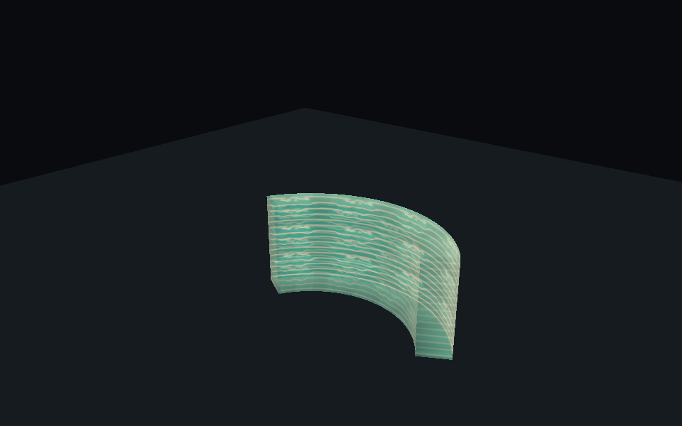
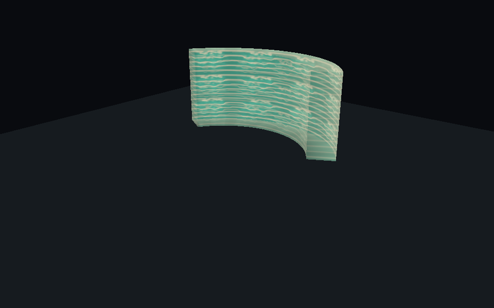

# 衝擊扇波 Radius／位移／高度分離驗證

最後核對日期：2026-10-08（本功能局部核對）
核對來源：Unity MCP、EditMode、正式 Player／Enemy Prefab 受控 Runner 與隔離視覺預覽。
配置與公式：[44 說明書](../../44_衝擊扇波推進與特效.md)。

## 已確認範圍

使用者確認圖解：固定弧形波牆，上下同寬；Radius 決定尺寸、Travel Distance 決定位移、Wave Height 獨立。
空中使用施放當下高度，不貼地、不隨玩家後續移動／轉向。

本輪未儲存 Scene、技能／視覺 Prefab 或材質。技能 Prefab 與本輪前副本 SHA256 一致。
保留人工 Radius=20、Damage=30、Wave Speed=60、Thickness=1、Knockback Distance=30、Knockback Speed=80。
新增 Travel Distance=20、Wave Height=3 為 C# 初始值；Inspector 載入已核對。

## 證據

| 層級 | 結果 |
|---|---|
| 預期失敗 | [red.json](red.json)：兩項實際失敗，舊波隨距離放大、頂部寬度接近零。job bdf4db142e914be980dbc193d3e1c114；result=null，以 completed=2 及兩項失敗明細為證。 |
| 最終聚焦 EditMode | [focused.json](focused.json)：73/73 通過、0失敗。job 8b2b736e2aa84a71acacbf37d0076f17。 |
| 完整 PurgersRegression | [regression.json](regression.json)：completed=518、discovered=533、status=failed、result=null。僅回報 BossStageAssetTests.GameSceneContainsBossAssetWiring 失敗，不推算其餘通過／跳過數，也不是全綠。job 21c1238eaf874cdd8d7032abb47ec0fc。 |
| 修改前完整回歸 | job 311040b827e54152a8eb6379141b77f0：completed=507、discovered=522、同一 Boss 引用失敗，result=null；既有失敗不歸因本次。 |
| Play Mode Single Runner | [single-runner.txt](single-runner.txt)：24項 PASS。 |
| 同 Editor Photon Host／Client | [host-client.txt](host-client.txt)：16項 PASS；Multi Peer、實際 Photon 私人測試房、隔離物理 Scene。 |
| 編譯／Console／場景 | [editor-state.json](editor-state.json)、[console.json](console.json)：退出 Play Mode、編譯未失敗、Shader 無錯、視覺 Prefab Missing Script=0、_Menu 未 dirty；Console error／warning 0。 |
| 獨立 Host／Client、自然關卡／手感、Build | 未執行；受控雙 Runner 不替代獨立程序與自然遊玩驗收。 |

聚焦範圍：ShockwavePropagationTests、ShockwaveVisualTests、ActiveAbilityGizmoTests、ActiveAbilityPresentationTests、ActiveAbilityAssetsTests。
包含固定網格平移、上下同寬、距離不擴大尺寸、半徑不限制位移、獨立高度、空中座標、角度／內外弧邊界、跨 Tick 掃掠、可見頂點與權威範圍一致、封面 winding／非退化三角形、資產引用與成本。

## 受控實際驗證

Single Runner 使用正式玩家與 Enemy_Melee_A；只改臨時 Instance，AI 與擊退位移以既有測試方法隔離。

- 施放當刻不整區扣血；近／遠敵人按波牆抵達各扣一次。
- 零冷卻不覆寫進行中波；多 Collider／多 Tick 去重，遮擋與範圍外不命中。
- 發射後修改 radius／travelDistance／waveHeight 不影響當次快照。
- 高速跨 Tick 能命中靜止敵人。
- 在空中施放後讓玩家回地面並轉向，原點／方向不變。
- 空中牆內目標受傷，牆下地面目標不受傷。
- 完成、死亡後清除本機視覺。

Host／Client：

- Host 指定 R=4、位移=100、高=6、厚=2，Client 收到這些值，而非各自 Prefab 預設。
- 晚加入從已前進位置顯示，兩端各一份本機 VFX；Proxy 無法直接增加施放序號。
- 取消同步、重連不補播；Client Input Authority 透過正式 NetInput 路由給 Host。
- Runtime Despawn 同步。

不宣稱重新驗過自然場景、不同網路品質、正式關卡轉場、自然骨架露出牆角等所有情況。

## 隔離視覺預覽

使用現有材質與視覺 Prefab，示意 R=4、高3、位移10。只用臨時 Preview Scene，沒有改正式技能 Radius=20。
上下弧同寬，空中版本仍有完整頂底封面。

Prefab 48×8 實測1114頂點／1760三角形、1 Mesh／Renderer／材質、1張512貼圖；預設48×24為2746頂點／4896三角形。
詳細成本與退化極限見44。這些圖不是自然遊戲攝影機驗收，也不是 GPU 效能證據。

## 手動續驗

1. 開啟 Shockwave.prefab，在 Inspector 分別調 Radius、Travel Distance、Wave Height，觀察起點／終點 Gizmo。
2. 如需圖解尺寸，可手動將 Radius=4、Travel Distance=10、Wave Height=3；原人工 Radius=20 尚保留。
3. 地面與跳躍中按 E，確認上下同寬、大小固定；出手後走動／落地不拖動已發射波。
4. 在高度範圍內外放目標，檢查傷害與遮擋；自行驗收擊退撞牆手感。
5. 重新建置相同版本兩端後驗證獨立 Host／Client、晚加入／重連、自然施放與正式關卡流程。