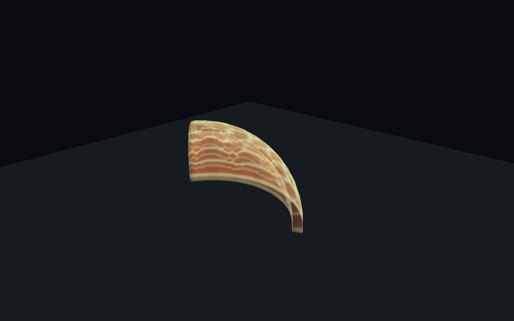

> 本頁是同日較早的擴張球殼版本歷史證據；圖解確認後已改為固定尺寸波牆。現況與本次測試見 [尺寸／位移分離紀錄](../ShockwaveSeparation/README.md)。

# 衝擊扇波驗證紀錄

最後核對日期：2026-10-08（本功能局部核對）
核對來源：Unity MCP、Unity Editor、實際正式 Player／Enemy Prefab 的受控執行、原始測試回應。
配置與責任：[44 衝擊扇波推進與特效](../../44_衝擊扇波推進與特效.md)。

## 本次結果

| 層級 | 結果與證據 |
|---|---|
| 預期紅燈 | 新增的 10 項幾何測試確實執行並因缺少共用規則失敗。job b5499bb6ab48431e9a9b47c51e8d726e，[原始回應](red-tests.json)。最初 total=0 的回應不列作測試證據。 |
| 最終聚焦 EditMode | **62/62 通過**。job 415ef91fa44d4760ba5413a5a595933c，[原始回應](focused-tests.json)。涵蓋 ShockwavePropagationTests、ShockwaveVisualTests、ActiveAbilityGizmoTests、ActiveAbilityPresentationTests、ActiveAbilityAssetsTests。 |
| 完整 PurgersRegression | job e2dfe23aaf5c44c38f37b3d42dfb5f98，[原始回應](regression.json)。progress.completed=507、discovered total=522、status=failed，列出 1 項 Boss 引用失敗；result=null，不推算通過或跳過數，**不是全綠**。 |
| Play Mode Single Runner | **19 項 PASS**，[紀錄](single-runner.txt)。真實 Spawned 玩家與 Enemy_Melee_A，參數只改臨時 Instance。 |
| 同 Editor Photon Host／Client | **16 項 PASS**，[紀錄](host-client.txt)。Multi Peer、隔離物理 Scene、真實 Photon 連線，含晚加入與重新連線。不是獨立程序證據。 |
| 最終 Editor 狀態 | [紀錄](editor-state.json)：isPlaying=false、compiling=false、scriptCompilationFailed=false、扇波 Shader 無錯、新視覺 Prefab Missing Script=0、Runner=0、_Menu.isDirty=false。 |
| Console | [最終 MCP 回應](console.json)：error／warning 回傳 0 筆；另以 EditorUtility.scriptCompilationFailed 與 ShaderUtil 檢查，不能只用空 Console 證明編譯成功。 |
| 獨立 Host／Client、自然遊玩、Build | 本次未執行；不可由受控雙 Runner 結果推定通過。 |
| 美術接受度／效能 | 隔離預覽已產生並檢視；尚待使用者於遊戲中確認外觀、遮擋與多人同屏成本。 |

完整回歸唯一回報：
`BossStageAssetTests.GameSceneContainsBossAssetWiring`，Expected same MapChunk_Boss，但引用不同。
[既有 AbilityReleaseSafety 基線](../AbilityReleaseSafety/README.md) 與 [GrappleVisual 紀錄](../GrappleVisual/README.md) 已記錄此失敗，本輪未修改該 Boss 引用或 Scene。

## 實際探測範圍

Single Runner：
- 施放時近／遠敵人血量不變，波前抵達後分別扣血。
- 零冷卻不能覆蓋仍在飛行的波；同敵人多 Collider／多 Tick 只扣一次。
- 水平扇區外與完全遮擋目標不受傷。
- 高速跨 Tick 仍掃中靜止目標；波尾結束、玩家死亡清理主波。
- 真實敵人 Root 與骨架 Collider 可能偏移；因此取候選保留完整射程 OverlapSphere，再按波帶篩選 Root，避免只查目前波前造成漏傷害。
- 遮擋案例關閉該測試敵人的巨大骨架 Collider，使用已知位置的單一測試碰撞體並先斷言遮擋。其他案例保留正式骨架，AI 停用，擊退使用既有測試免疫元件，避免位移干擾血量／時序斷言。此項不代表重新驗證自然骨架露出牆角的全部情境。

同 Editor Host／Client：
- Host 保存射程／厚度快照；Client 收到 Host 改值，不能自行啟動能力或增加序號。
- Client 在波進行途中加入，從當前進度顯示；兩 Runner 各有一份本機視覺。
- Host 取消後兩端停止／清理，重連不補播已過期的波。
- Client 自有玩家僅有 Input Authority；NetInput.Ability1 經既有路由送至 Host，Host 正式受理一次。
- Runtime Despawn 同步到 Client。
- 測試專用 SceneManager 沿用 Fusion 建立的隔離物理 Scene，只處理動態測試物件；不載入正式關卡，不驗證 Game／SafeHouse 切換。
- 初版探針因 Default SceneManager 在無已載入 Scene Root 時持續 Busy 而等待超時；修正測試容器後才取得上述成功紀錄。此為測試啟動修正，未替換正式場景管理。

## 預覽與素材

固定攝影機、射程 20m、半角 60°、厚度 1m，主波依前進距離自然加寬：
[5m](wave_05.png)／[10m](wave_10.png)／[18m](wave_18.png)。

此為隔離美術預覽，不是遊戲內鏡頭或傷害測試截圖。保留原三維球距，因此波面沿上下球殼延伸；沒有私自新增固定高度的地面扇形判定。

- 素材：[Kenney Particle Pack](https://kenney.nl/assets/particle-pack)，官方標示 CC0，512×512。
- 正式加入 PNG (Transparent)/smoke_04.png 原圖，原始 License.txt 同目錄保存；不含範例腳本或整包其他貼圖。
- 匯入位置：Assets/Art/VFX/Shockwave/Kenney/smoke_04.png。
- SHA256：2DB2F69874CDB1E5203F2F86803D5DEBDE30402590CF50A810AFABA882184616。
- 原包來源：https://kenney.nl/media/pages/assets/particle-pack/f8fe0f8cb8-1677578741/kenney_particle-pack.zip。
- 新主波預設 1 Mesh、1 MeshRenderer、1 共享材質、2550 頂點、4704 三角形、1 張 512 貼圖；完整成本與球極退化面說明見 44。
- 程式控制扇形網格，素材只提供流動細節，因此調射程／半角／速度／厚度不必改粒子 Lifetime。
- 牆後傷害會被拒絕，但沒有依障礙裁切整片網格；場景深度只遮擋被牆遮住的畫面部分。

## 手動續驗

1. 開啟 Shockwave.prefab，先核對目前人工值 damage=30、radius=20、halfAngle=60、knockbackDistance=30、knockbackSpeed=80；本輪未儲存該 Prefab。
2. 新欄位 Wave Speed 預設 20m/s、Wave Thickness 預設 1m；Wave Visual Prefab 留空自動載入 Resources 預設主波。
3. 在自然 E 施放與正常關卡觀察近／遠敵人受傷時間、走動轉向不拖動已發出的波、擊退撞牆既有行為。
4. 改半角、射程與波速後重新施放，檢查外觀同步；Inspector 中途改值只套用下一波。
5. 以同版本重新建置兩端，驗證自然 Host／Client、延遲／丟包、晚加入／重連、能力換裝與關卡切換。
6. 在實際目標平台量測多波同屏透明疊畫／CPU 成本，再決定網格分段與細節；目前未做 GPU 預算驗收。

本輪沒有自動放置 Scene 物件、儲存既有 Scene／技能 Prefab，也沒有重設既有 dirty 工作樹。
